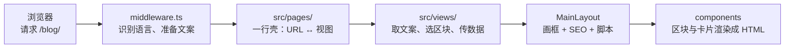

# 架构与使用指南：这个框架给了你什么，你该怎么用它

> 面向：想弄明白网站由什么组成、并决定「接下来我该怎么继续改」的人。
>
> 配套文档：[改造指南](./customization.md)（把模板变成自己博客的完整步骤）、[开发与维护手册](./development.md)（架构、命令与排错细节）。

---

## 0. 直接回答你最关心的问题

**你不需要从零重写页面。** 这个网站给了你一套「画框 + 积木 + 数据管道」，你有三层自由度，而且可以随意混用：

| 自由度 | 你要做的事 | 要写代码吗 |
| --- | --- | --- |
| **① 改内容** | 改文案表 / JSON / 图片 / 写文章 | 完全不用 |
| **② 拼积木** | 用现成区块组装一个新页面 | 只写几行「胶水」 |
| **③ 自己写** | 页面主体完全按自己的想法写 | 写页面，但导航栏/页脚/SEO/样式体系仍然是免费白拿的 |

一句话总结：**「完全独立写」指的是页面内容本身，而不是整个网站——画框和展厅永远由框架负责。**

---

## 1. 网站是怎么跑起来的

把「一次访问」想象成一条流水线，一个页面从 URL 到 HTML 要经过 5 站：



每一站只做一件事，互不干涉：

- **第 1 站 `src/middleware.ts`**：给每次请求发一个「随身包」（`Astro.locals`），里面装着当前语言和文案表。
- **第 2 站 `src/pages/*.astro`**：一行壳。文件路径 = URL（`pages/blog/index.astro` 就是 `/blog/`）。
- **第 3 站 `src/views/*.astro`**：页面实现。它从「随身包」或文案表取文字、挑选区块组件、把数据传进去。
- **第 4 站 `MainLayout.astro`**：每个页面的统一外壳。页面告诉它「我是什么」（标题、类型），它负责生成整个 `<head>`（SEO、分享卡片、结构化数据）并套上导航栏与页脚。
- **第 5 站 组件**：区块（sections）负责版式，原子（ui）负责小零件，卡片直接「吃」内容条目。

**一句话总结：URL 找壳、壳找视图、视图拼积木、布局负责画框——每一层都很薄，所以你改哪一层都不会牵一发而动全身。**

---

## 2. 目录地图：每个文件夹负责什么

| 你想找的东西 | 去哪 |
| --- | --- |
| 网页上的一句话 | `src/copy/zh.ts`（全站文字总字典） |
| 一个页面的组成 | `src/views/`（首页、博客、联系页……每个页面一个文件） |
| 某个版块（首屏、FAQ、定价……） | `src/components/sections/` |
| 小零件（按钮、卡片、图标、输入框……） | `src/components/ui/` |
| 页面外壳、SEO、导航栏、页脚 | `src/layouts/MainLayout.astro` |
| 站名、域名、作者 | `src/data_files/constants.ts` |
| 导航链接、页脚链接、社交账号 | `src/data_files/navigation.ts` |
| FAQ / 功能点 / 定价等列表数据 | `src/data_files/*.json` |
| 文章、随想、产品 | `src/content/{blog,insights,products}/zh/` |
| 「文章怎么变成 URL」的规则 | `src/utils/content.ts` |
| 「SEO 标签怎么生成」的规则 | `src/utils/metadata.ts` |
| 构建配置（域名、sitemap、文档站） | `astro.config.mjs` |

**一句话总结：文字去 copy、版式去 components、图片去 images、数据去 data_files——四类东西各有各的家，互不混放，这就是全站秩序感的来源。**

---

## 3. 框架给了你什么（能力清单）

### 3.1 页面外壳（白拿的部分）

任何页面只要用 `<MainLayout>` 包起来，就自动获得：

- **导航栏 + 页脚**：全站一致，改一处全站生效；
- **完整 SEO**：标题、描述、canonical、Open Graph 分享卡片、hreflang、schema.org 结构化数据（无需自己写）；
- **样式底座**：Tailwind 样式、暗色模式（跟随系统）、平滑滚动、响应式布局；
- **交互组件**：Preline 的折叠/下拉/模态框，自动初始化。

### 3.2 区块（sections）——大块积木

首屏（HeroSection / HeroSectionAlt）、客户 logo 墙（ClientsSection）、图文特性（FeaturesGeneral / FeaturesNavs）、数据展示（FeaturesStats）、用户评价（TestimonialsSection）、定价（PricingSection）、FAQ、联系方式（ContactSection）、产品详情（ProductDetail）、随想详情（InsightDetail）……

每个区块都是「只负责版式」的组件，文字通过 props 传入。完整的清单见 [第 5 节](#5-积木清单)。

### 3.3 原子（ui）——小零件

约 50 个小组件：卡片（CardBlog / CardProduct / CardInsight……）、按钮（PrimaryCTA / SecondaryCTA……）、表单输入框、头像、图标渲染器、公告横幅、统计块、选项卡、星星评分……

其中你一定会用到的是 **图标系统**：

```astro
<Icon name="tools" class="h-6 w-6 text-orange-400" />
```

图标名有类型检查（拼错会在构建时报错），颜色用 `text-*` 类控制（会自动变成图标颜色）。

### 3.4 样式系统

Tailwind v4 + 一份主题色定义（在 `src/assets/styles/global.css` 的 `@theme` 里）。全局只有一套颜色变量，改主色就是改这几个变量。没有 `tailwind.config.js` 这个文件——Tailwind v4 用 CSS 写配置。

### 3.5 内容系统（写文章就发布）

把 Markdown 文件丢进 `src/content/blog/zh/`，填好 frontmatter：

- URL 自动生成（文件名即网址，见 `src/utils/content.ts`）；
- **字段校验**：忘写字段、字段名拼错，构建时直接报错（schema 在 `src/content.config.ts`）；
- 列表页、详情页、卡片、相关文章全部自动收录，无需注册。

### 3.6 数据系统（改数据不改组件）

FAQ、功能点、定价档位等「可枚举数据」放在 `src/data_files/*.json`。你改 JSON，页面自动更新——因为组件只认字段名，不认内容。

### 3.7 完整体验组件（都是现成的）

- 文章详情页：分享按钮、本地书签、反馈、相关文章——**新文章自动拥有**；
- 演示表单：`<DemoForm>` 包住输入框即可获得提交拦截与成功提示（未接后端，接法见开发手册）；
- 404 页面、sitemap、robots.txt、favicon 生成、社交分享图——都已经配好。

### 3.8 工具链（质量保障）

- `pnpm build`：先做**类型检查**（含文案表完整性、图标名、frontmatter 校验），再构建、压缩；
- `pnpm test:smoke`：启动构建产物，逐条检查关键路由；
- Prettier 统一代码格式。

**一句话总结：框架把「每个页面都要重复做的事」（画框、SEO、样式、校验、测试）全部包办了，留给你的只有「这个页面要显示什么」。**

---

## 4. 三种自由度：你该怎么选

### 方式 ①：只改内容（零代码）

适合：调整文字、换图片、写新文章、改 FAQ。

- 改文字 → `src/copy/zh.ts`；
- 换图片 → 替换 `src/images/` 下的同名文件；
- 写文章 → 在 `src/content/blog/zh/` 新建 `.md` 文件；
- 改列表数据 → `src/data_files/*.json`。

### 方式 ②：用现成积木拼一个新页面（推荐）

适合：想要一个「关于」「友链」「归档」之类的页面，布局能用现成区块对上 60% 以上。

流程只有 4 步（以「关于」页为例）：

1. **加文案**：在 `src/copy/zh.ts` 里加一个 `about` 块（标题、正文……）；
2. **写视图**：新建 `src/views/AboutView.astro`，用 `<MainLayout>` 包住你想用的区块：

   ```astro
   ---
   import MainLayout from '@/layouts/MainLayout.astro';
   import MainSection from '@components/ui/blocks/MainSection.astro';
   import { getCopy } from '@/copy';
   import type { MarketingLocale } from '@utils/locale';

   interface Props {
     locale: MarketingLocale;
   }
   const { locale } = Astro.props;
   const copy = getCopy(locale).about;
   ---

   <MainLayout title={copy.title} description={copy.metaDescription}>
     <MainSection heading={copy.heading} content={copy.content} />
   </MainLayout>
   ```

3. **加壳**：新建 `src/pages/about.astro`，一行：`<AboutView locale="zh" />`；
4. **加导航**（可选）：`src/data_files/navigation.ts` 里加 `{ id: 'about', path: '/about' }`，文案表加对应标签。

### 方式 ③：页面主体完全自己写

适合：布局太特殊，现成区块对不上；或者你就是想自己写 HTML。

**可以完全自由。** 视图里你想写什么就写什么——唯一建议是仍然用 `<MainLayout>` 包一层：

```astro
<MainLayout title="我的页面" description="描述">
  <!-- 这里从零开始，用 Tailwind 类随便写 -->
  <section class="mx-auto max-w-3xl px-4 py-16">
    <h1 class="text-4xl font-bold">完全自定义的页面</h1>
  </section>
</MainLayout>
```

这样你「独立写的」只是页面内容，而导航栏、页脚、SEO、暗色模式、平滑滚动依然是免费获得的。如果你连布局也不想要（比如做一个全屏页面），可以不用 MainLayout，自己写完整 HTML——但那意味着 SEO、导航栏都要自己处理，一般没必要。

**一句话总结：三种方式不是三选一，而是可以混着用——首页用积木拼、文章页用现成模板、真正特别的页面自己写，各自互不影响。**

---

## 5. 积木清单

### 5.1 区块（sections）

- **首屏类**：`HeroSection`（左文右图 + 评价星星）、`HeroSectionAlt`（居中收尾横幅）
- **信任类**：`ClientsSection`（logo 墙）、`TestimonialsSection`（评价卡片）、`TestimonialsSectionAlt`
- **特性类**：`FeaturesGeneral`（图文）、`FeaturesNavs`（选项卡切换）、`FeaturesStats` / `FeaturesStatsAlt`（数据块）
- **定价**：`PricingSection`
- **常用**：`FAQ`（手风琴问答）、`ContactSection`（联系方式 + 表单）、`AnnouncementBanner`（顶部公告条）
- **内容详情**：`ProductDetail`（产品：选项卡/规格表/蓝图）、`InsightDetail`（随想：目录 + 进度条）
- **框架**：`Navbar` / `NavbarMegaMenu`（两种导航栏，可切换）、`FooterSection`

### 5.2 回复到「数据入口」的积木

这些区块的输入不是文字，而是数据，所以有两种使用姿势：

| 区块 | 输入 | 改内容的方式 |
| --- | --- | --- |
| `FAQ` | FAQ 数组 | 改 `src/data_files/faqs.json` |
| `FeaturesGeneral` | 功能点数组 | 改 `src/data_files/features.json` |
| `PricingSection` | 定价档位 | 改 `src/data_files/pricing.json` |
| `CardBlog` / `CardBlogRecent` | 博客条目 | 写文章即可 |
| `CardProduct` | 产品条目 | 加产品 Markdown |
| `ClientsSection` | logo 列表 | 改 `constants.ts` 的 `partnersData` |

### 5.3 原子（ui）——挑几个高频的

`PrimaryCTA` / `SecondaryCTA`（按钮）、`CardBlog` 等卡片、`DemoForm`（表单壳）、`Icon`（图标）、`NavLink`、`Avatar` 系列、`Stats*` 系列、`TabNav` / `TabContent`（选项卡零件）、`AccordionItem`（折叠项）。

**一句话总结：先翻一遍积木清单，能对上的直接传 props；对不上的先用 ui 原子搭；实在不行再自己写——大多数情况走到第二步就够了。**

---

## 6. 从「公司官网风」切换到「个人博客风」

你现在感觉网站像公司官网，是因为首页默认堆满了营销区块。如果想让站点以博客为中心，可以做这几件事（全部在 `HomeView.astro` 里动手术）：

**首页精简（推荐保留的前 3 块）：**

1. `HeroSection` → 保留，把文案改成个人介绍（已在 `copy.zh.ts` 里配好）；
2. `AnnouncementBanner` → 可保留（“阅读最新文章”入口）或删掉；
3. `BlogIndexView` 是独立页面（导航栏「博客」），不需要搬上首页。

**建议删掉的营销区块**（在 `HomeView.astro` 里删掉对应的 import 和标签即可，删一个不会牵连其他）：

- `ClientsSection`（客户 logo 墙）——个人博客没有客户；
- `PricingSection`（定价）——除非有赞助/打赏需求；
- `TestimonialsSection`（读者评价）——可以保留少量，也可以删；
- `FeaturesNavs` / `FeaturesGeneral`（特性介绍）——可以改造成「站点介绍」或者删。

**导航栏**：`src/data_files/navigation.ts` 里把 `products`、`services` 从 `navLinks` 中删掉，只留首页/博客/联系。对应的页面文件（`src/pages/products/`、`src/pages/services.astro`）和文案块可以按 `docs/customization.md` 第 8 节整块移除。

**页脚**：同样在 `navigation.ts` 的 `footerSections` 里删，文案表同步对删。

做完这些，首页会从「官网落地页」变成「博客首页 + 一句自我介绍」，导航栏也会干净很多。

---

## 7. 你什么时候才需要动「底层」

绝大部分时候，**不需要**。下面是「需要动 utils/ 的少数场景」：

| 场景 | 要动的文件 |
| --- | --- |
| 加一种语言 | `src/utils/locale.ts` + 新建文案表 + 复制页面壳 |
| 加一个新内容类型（如相册） | `src/content.config.ts` 加集合 + `src/utils/content.ts` 加路由 |
| 站点换域名 | `constants.ts` 的 `SITE.url` + `astro.config.mjs` 的 `site` |
| 换 SEO 结构（如加自定义 meta） | `src/utils/metadata.ts` |

除此之外的日常使用——写文章、加页面、改版式、换颜色、加图标——都不需要碰这三个文件。

**一句话总结：底层是「规则」，中层是「积木」，日常你只在中层活动。**

---

## 8. 一分钟速查（把这张表存在脑子里就够用了）

- 想改**文字** → `src/copy/zh.ts`
- 想改**版式** → `src/views/` 或 `src/components/sections/`
- 想加**页面** → 视图（`views/`）+ 壳（`pages/`）+ 文案（`copy/`）
- 想写**文章** → `src/content/blog/zh/` 新建 `.md`
- 想改**数据** → `src/data_files/*.json`
- 想改**品牌/域名** → `src/data_files/constants.ts`
- 想改**导航/页脚** → `src/data_files/navigation.ts`
- 想**验证**改动 → `pnpm build && pnpm test:smoke`

---

**最后一句话**：这个项目不是「一个只能按原样使用的官网模板」，而是一盒「按页面部件分好的积木 + 一套自动化的画框与出版流程」。你越熟悉 `views/`（页面怎么拼）和 `copy/`（文字在哪）这两个文件夹，就越能自由地在它上面长出自己的博客——而且随时可以从「公司风」变回「个人博客风」，代价只是删掉几个区块标签。