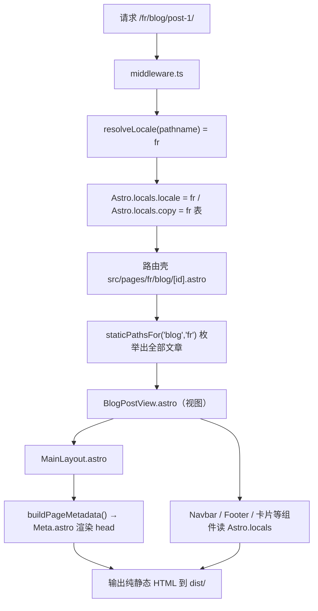

# 开发与维护帮助文档（ScrewFast-Blog）

> 面向对象：后续接手、维护、扩展这个博客站的人。
>
> 这份文档讲**架构、约定、扩展方式与排错**；"把模板改造成自己的博客"的完整操作步骤见 [`customization.md`](./customization.md)。
>
> 仓库内其它文档：`README.md`（模板功能与上手）、`AI_GUIDE.md`（给 AI 助手的约定摘要）、`CONTEXT.md`（领域术语的英文速查表）。

## 目录

- [1. 技术栈一览](#1-技术栈一览)
- [2. 环境与常用命令](#2-环境与常用命令)
- [3. 目录结构地图](#3-目录结构地图)
- [4. 核心概念（术语表）](#4-核心概念术语表)
- [5. 页面是怎样生成的（请求流水线）](#5-页面是怎样生成的请求流水线)
- [6. 五个"唯一来源"模块](#6-五个唯一来源模块)
- [7. 内容集合与 Schema](#7-内容集合与-schema)
- [8. 组件体系](#8-组件体系)
- [9. 样式、主题与前端脚本](#9-样式主题与前端脚本)
- [10. 构建、测试与产物](#10-构建测试与产物)
- [11. 部署与运维](#11-部署与运维)
- [12. 常见任务（HOW-TO）](#12-常见任务how-to)
- [13. 故障排查](#13-故障排查)
- [14. 文档索引](#14-文档索引)

---

## 1. 技术栈一览

| 技术 | 角色 | 关键点 |
| --- | --- | --- |
| **Astro 7** | 静态站点生成器（SSG） | 构建时把页面渲染成纯 HTML，无运行时框架 |
| **Tailwind CSS 4** | 样式 | 通过 `@tailwindcss/vite` 插件接入；**配置在 CSS 里**（`global.css` 的 `@theme`），没有 `tailwind.config.js` |
| **Preline 5** | 交互组件（模态、下拉、折叠） | 在 `MainLayout.astro` 里 `import 'preline'` + `HSStaticMethods.autoInit()` |
| **Starlight** | `/welcome-to-docs/` 下的文档站 | 独立于营销站点的一套 locale 和处理流程 |
| **Lenis** | 平滑滚动 | 尊重 `prefers-reduced-motion`；与 Starlight 有已知兼容问题（见排错） |
| **GSAP** | 滚动动画 | 仅产品详情页、Insights 详情页使用 |
| **TypeScript（strict）** | 类型检查 | `astro check` 同时校验类型与**文案表完整性** |
| **pnpm** | 包管理 | 锁文件 `pnpm-lock.yaml` |

---

## 2. 环境与常用命令

要求：**Node.js 22** + **pnpm 9+**。

| 命令 | 作用 |
| --- | --- |
| `pnpm dev` | 开发服务器（http://localhost:4321），热更新 |
| `pnpm build` | 类型检查 → 构建到 `dist/` → HTML 压缩（三步管道，见第 10 节） |
| `pnpm preview` | 本地预览 `dist/` 产物 |
| `pnpm test:smoke` | 冒烟测试：为 `dist/` 起静态服务器，逐个检查关键路由与内容断言 |
| `pnpm format:check` / `pnpm format:fix` | Prettier 检查 / 格式化（含 Astro 插件） |
| `pnpm astro …` | 直接调用 Astro CLI |

---

## 3. 目录结构地图

```
src/
├── middleware.ts        # 每个请求解析 locale，注入 Astro.locals.locale / copy
├── env.d.ts             # Astro.locals 的类型声明（locale / copy）
├── content.config.ts    # 4 个内容集合的 loader 与 schema
├── pages/               # 路由"一行壳"：pages 英文路由，pages/fr/ 法文路由
├── views/               # 每路由一个视图（页面实现），接收 locale 或内容条目
├── layouts/             # MainLayout：Navbar + main + Footer + 整个 <head>
├── components/
│   ├── sections/        # 页面区块：landing / features / pricing / testimonials /
│   │                    #   navbar&footer / products / insights / misc
│   └── ui/              # 原子组件：buttons / cards / forms / icons / avatars / ...
├── copy/                # 文案表：en.ts（定义结构）、fr.ts（必须同构）、index.ts（getCopy）
├── data_files/          # 结构化配置：constants.ts / navigation.ts / mega_link.ts / *.json（+ fr/）
├── content/             # 内容集合：blog / insights / products（各含 en/ fr/）+ docs（Starlight）
├── utils/               # locale.ts / content.ts / metadata.ts / utils.ts
├── assets/              # styles/（global.css 等）与 scripts/（Lenis、demoForms 等）
└── images/              # 被 import 处理的图片（Astro 优化）

public/                  # 原样拷贝的静态文件（仅 banner-pattern.svg）
scripts/smoke.mjs        # 冒烟测试脚本
process-html.mjs         # 构建后 HTML 压缩脚本
astro.config.mjs         # site / sitemap / Starlight / Tailwind 插件
vercel.json              # 安全响应头 + 法语 404 重写
tsconfig.json            # 路径别名定义
```

**路径别名**（`tsconfig.json`，建议所有 import 都用别名，别写 `../../`）：

| 别名 | 指向 |
| --- | --- |
| `@/*` | `src/*` |
| `@components/*` | `src/components/*` |
| `@content/*` | `src/content/*` |
| `@data/*` | `src/data_files/*` |
| `@images/*` | `src/images/*` |
| `@scripts/*` | `src/assets/scripts/*` |
| `@styles/*` | `src/assets/styles/*` |
| `@utils/*` | `src/utils/*` |
| `@views/*` | `src/views/*` |

例：`import { SITE } from '@data/constants'`。

---

## 4. 核心概念（术语表）

| 术语 | 含义 |
| --- | --- |
| **Marketing Locale** | 营销站点的语言：`en`（默认，URL 无前缀）或 `fr`（`/fr/…`）。规则全部归 `src/utils/locale.ts` 管 |
| **Copy Table** | 一种语言的全部界面文字表（`src/copy/en.ts` / `fr.ts`）。英文表定义结构（类型 `Copy`），其它语言必须满足它 |
| **View** | 一个路由在任意语言下的实现（`src/views/*View.astro`），接收 `locale` 或内容条目作为 props |
| **Content Entry** | 本地化集合（blog / insights / products）里的一篇 Markdown/MDX，id 形如 `<locale>/<slug>` |
| **Page Metadata** | 页面 `<head>` 所需的一切（title/OG/canonical/hreflang/JSON-LD），由 `src/utils/metadata.ts` 从"5 个已知量"推导 |
| **Page Kind** | 页面类型枚举：`WebPage` / `BlogPosting` / `Article` / `Product`，决定 JSON-LD 内容 |
| **Demo Form** | 模板占位表单（联系、订阅、登录等），`DemoForm.astro` 统一负责拦截与提示，未接后端 |
| **Icon** | `src/components/ui/icons/icons.ts` 里的命名 SVG 图形，只存几何数据；尺寸/颜色由调用处决定 |

---

## 5. 页面是怎样生成的（请求流水线）

Static 站点在**构建时**执行下面的流程；`pnpm dev` 下则按请求即时执行：



逐步拆解：

1. **中间件**（`src/middleware.ts`）——每个请求（构建时也执行）解析一次 locale，把 `Astro.locals.locale` 和 `Astro.locals.copy` 挂好。全树组件直接读 `Astro.locals`，不需要逐层传参。
2. **路由壳**（`src/pages/…`）——通常只有 3~5 行：导入视图、把 `locale` 或 `entry` 传下去。带 `[id]` 的动态路由用 `staticPathsFor(collection, locale)` 生成 `getStaticPaths`。
3. **视图**（`src/views/…`）——从 copy 表取文案、组合 section 组件、传 props。
4. **布局**（`MainLayout.astro`）——`<head>` 完全由 `buildPageMetadata()` 推导（从 `title`/`description`/`ogTitle`/`section`/`kind` 这 5 个输入）；页面包在 Navbar + Footer 之间。
5. **组件**——`sections/` 里的区块和 `ui/` 里的原子组件，文字一律来自 copy 表。

---

## 6. 五个"唯一来源"模块

改代码前先读这五个文件——**全站规则都集中在这里**，绕过它们就会出 bug。

### 6.1 `src/utils/locale.ts` —— locale 的唯一来源

| API | 作用 |
| --- | --- |
| `MARKETING_LOCALES` / `DEFAULT_LOCALE` | 支持的语言列表（默认语言无 URL 前缀） |
| `LOCALE_INFO` | 每种语言的 `label` / `lang` / `ogLocale` / `inLanguage` / `intl` |
| `splitLocale(pathname)` | 把路径拆成 `{ locale, path }` |
| `resolveLocale(pathname, currentLocale?)` | 解析请求语言（路径优先） |
| `localePath(locale, path)` | 拼本地化路径：`localePath('fr','/products') → '/fr/products'` |
| `alternatePaths(pathname)` | 同一页面的全部语言版本（hreflang 用） |

**规则：任何地方都不要再手动解析 `/fr` 或拼语言前缀**，一律走这些函数。

### 6.2 `src/utils/content.ts` —— 内容 → URL 的唯一来源

| API | 作用 |
| --- | --- |
| `localeOf(entry)` / `slugOf(entry)` | 从 `id`（`<locale>/<slug>`）取语言 / slug |
| `pathFor(entry)` | 条目的站点路径，如 `/fr/blog/post-1/` |
| `entriesFor(collection, locale)` | 取某语言某集合的条目（按集合默认排序） |
| `siblingOf(entry, locale)` | 同条目在另一语言的翻译（有则返回） |
| `staticPathsFor(collection, locale)` | 直接给 `[id].astro` 用的 `getStaticPaths` 结果 |

**规则：永远不要自己 `entry.id.split('/')` 或拼 `/blog/${id}`。**

### 6.3 `src/copy/` —— 所有界面文字的唯一来源

- `en.ts` 定义结构；`fr.ts` 必须同构（缺 key 会在 `astro check` 报错）。
- 组件用 `Astro.locals.copy`，已有 locale 的代码用 `getCopy(locale)`。
- **逻辑只依赖 id**（如 `badge: 'hiring'`），不依赖翻译后的文字。
- 标题支持内嵌 HTML（用于彩色强调）。

### 6.4 `src/utils/metadata.ts` —— `<head>` 的唯一来源

- 输入：`locale`、`pathname`、`title?`、`description?`、`ogTitle?`、`section?`、`kind?`。
- 输出：`lang` / `title` / `description` / OG 字段 / `canonical` / `alternates`（hreflang）/ `jsonLd`。
- **页面永远不要手写 schema.org 对象或站点 URL**——改 `SITE` 常量即可全站生效。

### 6.5 `src/data_files/` —— 结构与数据，文字分离

- `constants.ts`：`SITE`（站名/域名/作者）、`OG`（分享图）、`partnersData`（客户 logo 墙）。
- `navigation.ts`：导航/页脚的 **id + 路径**、社交链接。文字按 id 放 copy 表 `nav` 块。
- `mega_link.ts`：可选 mega menu 的 id / 图标 / URL；文字在 `copy.nav.megaMenu`。
- `*.json`（+ `fr/`）：FAQ、功能点、价格档位，经 copy 表 `data` 字段暴露。

---

## 7. 内容集合与 Schema

四个集合在 `src/content.config.ts` 定义：

| 集合 | 位置 | 说明 |
| --- | --- | --- |
| `blog` | `src/content/blog/<locale>/` | 博客文章（`.md` / `.mdx`） |
| `insights` | `src/content/insights/<locale>/` | 带目录与滚动进度的文章类型 |
| `products` | `src/content/products/<locale>/` | 产品详情页（复杂字段） |
| `docs` | `src/content/docs/` | Starlight 文档站（自带 loader/schema） |

三个本地化集合的通用规则：

- loader 匹配 `**/[^_]*.{md,mdx}` —— **下划线开头的文件会被忽略**（可放草稿）。
- **id = `<locale>/<slug>`**，URL 由 `pathFor()` 统一生成；文件的目录名必须恰好是 `en` / `fr`。
- 默认排序：blog 按 `pubDate` 倒序；products 按 `main.id` 升序；insights 保持原序。

### blog 的 frontmatter 字段

| 字段 | 必填 | 说明 |
| --- | --- | --- |
| `title` | ✅ | 标题（进 `<title>` 与 JSON-LD） |
| `description` | ✅ | 摘要（卡片 + meta description） |
| `author` / `role` | ✅ / 可选 | 作者名与职位 |
| `authorImage` / `authorImageAlt` | ✅ | 头像（`@/images/blog/xxx.avif` 写法） |
| `pubDate` | ✅ | 日期，列表排序依据 |
| `cardImage` / `cardImageAlt` | ✅ | 列表卡片封面 |
| `readTime` | ✅ | 阅读分钟数（手填） |
| `tags` | 可选 | 标签数组 |

## 8. 组件体系

- **`components/sections/`**（页面区块）——`landing/`（HeroSection、HeroSectionAlt、ClientsSection）、`features/`（FeaturesGeneral、FeaturesNavs）、`pricing/`、`testimonials/`、`navbar&footer/`（`Navbar.astro`、`NavbarMegaMenu.astro`、`FooterSection.astro`）、`misc/`（FAQ、AnnouncementBanner 等）、`products/`、`insights/`。
- **`components/ui/`**（原子组件）——`buttons/`（Bookmark、SocialShare、ThemeIcon 类）、`cards/`（CardBlog、CardBlogRecent、CardInsight、CardRelated、CardProduct）、`forms/`（DemoForm）、`feedback/`（PostFeedback）、`icons/`、`avatars/`、`banners/`、`blocks/`、`stars/`、`links/`、`starlight/`（Starlight 定制组件）。
- **卡片组件吃 Content Entry**：如 `<CardBlog blogEntry={entry} />`，内部用 `pathFor()` 取链接，不需要额外传值。
- **Icon**：`<Icon name="tools" class="h-6 w-6 text-orange-400" />`。`name` 是类型化的（拼错会在 check 时报错）；图标只存几何，颜色由 `text-*` 类决定（`text-*` 通过 `fill-current` 生效）。
- **DemoForm**：`<DemoForm successMessage={…}>` 包住表单字段即可；拦截逻辑、状态元素、`data-demo-*` 属性都由组件和 `src/assets/scripts/demoForms.ts` 负责，**不要手写这些属性**。
- **Navbar 变体切换**：默认 `MainLayout` 使用 `Navbar.astro`；想启用 mega menu，把 `MainLayout.astro` 里的 import 换成 `NavbarMegaMenu.astro` 即可。模板中"没人引用"的可选模块（如 `NavbarMegaMenu`）是特意的功能示例，不要当成死代码删除。

---

## 9. 样式、主题与前端脚本

- **Tailwind v4**：入口 `src/assets/styles/global.css`。设计令牌（颜色）在 `@theme` 中定义；`@custom-variant dark` 声明暗色变体；`@plugin` 引入 `@tailwindcss/forms`、`@tailwindcss/typography`；`@source` 让 Preline 的样式被扫描。
- **暗色模式**：`MainLayout.astro` 内联脚本读取 `localStorage.hs_theme`（无记录时跟随系统），在 `<html>` 上加/去 `dark` 类；切换按钮见 `ThemeIcon.astro`。
- **平滑滚动（Lenis）**：`src/assets/scripts/lenisSmoothScroll.js` 在 `MainLayout` 中引入；检测到 `prefers-reduced-motion: reduce` 时会自动移除 `lenis` 类（禁用平滑滚动）。
- **Preline**：`MainLayout` 里 `import 'preline'` 并在 DOM 就绪后调用 `HSStaticMethods.autoInit()`。新增页面无需额外初始化。
- **GSAP**：只在 `ProductDetail.astro`、`InsightDetail.astro` 里用于滚动/淡入动画。轻量页面别随手引入（GSAP 体积不小）。
- **演示表单脚本**：`src/assets/scripts/demoForms.ts` 统一处理提交拦截与成功提示，提示文字来自 copy 表。

---

## 10. 构建、测试与产物

### 10.1 `pnpm build` 三步管道

```bash
astro check && astro build && node process-html.mjs
```

1. **`astro check`** —— TypeScript 类型检查 + 内容集合/文案表一致性校验。**文案漏 key、图标名拼错都会在这里失败。**
2. **`astro build`** —— 全站渲染到 `dist/`（同时生成 sitemap）。
3. **`process-html.mjs`** —— 压缩 HTML（`removeComments` / `collapseWhitespace` / `minifyJS`）。优先处理 `.vercel/output/static`（若存在），否则处理 `dist/`。

### 10.2 冒烟测试 `scripts/smoke.mjs`

- 为构建产物起一个本地静态服务器，逐个请求 `MARKETING_ROUTES` 里的路由（英文 + 法文各一份 + 两个 404），检查状态码，并对关键路由做**内容断言**（如 `/fr/` 必须含 `og:locale=fr_FR`、`/blog/post-1/` 必须含 `BlogPosting` JSON-LD）。
- **维护义务**：新增/删除路由、新增语言时同步更新 `LOCALE_PREFIXES` / `MARKETING_ROUTES` / `EXPECTATIONS`，否则测试会误报失败。

### 10.3 由代码生成的"页面"

这些页面不是静态文件，而是构建时生成的端点：

| 路由 | 文件 | 说明 |
| --- | --- | --- |
| `/favicon.ico` | `src/pages/favicon.ico.ts` | 用 `sharp` 从 `src/images/icon.png` 生成 16/32px |
| `/manifest.json` | `src/pages/manifest.json.ts` | PWA manifest，192/512 图标（any + maskable） |
| `/robots.txt` | `src/pages/robots.txt.ts` | 指向 `sitemap-index.xml`（域名来自 `astro.config.mjs` 的 `site`） |
| `/sitemap-index.xml` | `@astrojs/sitemap` | 含 en/fr 的 i18n 标注 |

---

## 11. 部署与运维

### 11.1 Vercel（默认）

`vercel.json` 提供两组配置：

**安全响应头**（全站）：

| 头 | 作用 |
| --- | --- |
| `Content-Security-Policy` | 限制资源来源。**新增外部资源（图床、字体、统计脚本）必须同步加白名单** |
| `Strict-Transport-Security` | 强制 HTTPS |
| `X-Content-Type-Options` / `X-Frame-Options` / `X-XSS-Protection` | 基础防护 |
| `Referrer-Policy` / `Permissions-Policy` | 隐私相关 |
| `Cache-Control` | `max-age=0, must-revalidate`（配合指纹资源） |

**重写**：`/fr/:path*` → `/fr/404`。

### 11.2 404 策略（重要）

静态构建全站只有一个 `404.html`（英文）。做法：

- `/404.astro` 构建出英文 404；
- `/fr/404/` 构建出法文 404（一个真实路由）；
- Vercel 用 `rewrites` 把不存在的 `/fr/…` 指向法文 404（返回 200 状态）；
- **Netlify** 替代方案：`_redirects` 里写 `/fr/* /fr/404/index.html 404`。

### 11.3 其它平台

纯静态输出 `dist/`，可托管在任何静态服务上。部署到子路径（如 GitHub Pages 的 `user.github.io/blog/`）需额外配置 `base`，模板默认按根路径设计。

### 11.4 依赖更新

Dependabot 保持依赖新鲜；升级前跑 `pnpm build && pnpm test:smoke`。

---

## 12. 常见任务（HOW-TO）

### 12.1 新增一个页面（以 `/about` 为例）

**第 1 步：文案** —— `src/copy/en.ts` 加一个块（`fr.ts` 同步）：

```ts
about: {
  title: '关于',
  metaDescription: '关于这个博客和它的作者',
  heading: '关于我',
},
```

**第 2 步：视图** —— 新建 `src/views/AboutView.astro`：

```astro
---
import MainLayout from '@/layouts/MainLayout.astro';
import { getCopy } from '@/copy';
import type { MarketingLocale } from '@utils/locale';

interface Props {
  locale: MarketingLocale;
}

const { locale } = Astro.props;
const copy = getCopy(locale).about;
---

<MainLayout title={copy.title} description={copy.metaDescription}>
  <section class="mx-auto max-w-3xl px-4 py-16 sm:px-6 lg:px-8">
    <h1 class="text-4xl font-bold text-neutral-800 dark:text-neutral-200">
      {copy.heading}
    </h1>
  </section>
</MainLayout>
```

**第 3 步：两个路由壳** —— `src/pages/about.astro`：

```astro
---
import AboutView from '@views/AboutView.astro';
---

<AboutView locale="en" />
```

`src/pages/fr/about.astro` 同样一行，`locale="fr"`。

**第 4 步：加进导航（可选）** —— `src/data_files/navigation.ts` 的 `navLinks` 加 `{ id: 'about', path: '/about' }`，并在两个 copy 表的 `nav.labels` 加上 `about`。

**第 5 步：冒烟测试（推荐）** —— `scripts/smoke.mjs` 的 `MARKETING_ROUTES` 加 `/about/`。

### 12.2 新增首页区块

1. 新组件放 `src/components/sections/`（选一个语义子目录）。
2. 文案加进 `copy.home`（en + fr）。
3. 在 `src/views/HomeView.astro` import 并按顺序使用。

### 12.3 新增图标

在 `src/components/ui/icons/icons.ts` 的 `Icons` 对象里按现有条目格式添加（`paths` + `viewBox` + `fill: 'currentColor'`），`IconName` 类型会自动包含新名字。使用：`<Icon name="新名字" class="h-5 w-5 text-yellow-500" />`。

### 12.4 新增一种语言

按顺序改（以 `zh` 为例）：

1. `src/utils/locale.ts`：`MARKETING_LOCALES` 加 `'zh'`；`LOCALE_INFO` 补全 5 个字段（`label`/`lang`/`ogLocale`/`inLanguage`/`intl`）。
2. `src/copy/zh.ts`：复制 `en.ts` 全部翻译；`src/copy/index.ts` 注册。
3. `src/pages/zh/`：复制 `fr/` 的路由壳（每个壳里 `locale="zh"`）。
4. `src/content/{blog,insights,products}/zh/`：翻译内容（可先后补，页面会自动"没有文章"而不是报错）。
5. `astro.config.mjs`：sitemap 的 `i18n.locales` 加条目；Starlight `locales` 加条目（如需文档翻译）。
6. `vercel.json`：如需该语言的 404，仿照 `/fr` 加 rewrite。
7. `scripts/smoke.mjs`：`LOCALE_PREFIXES` 加 `'/zh'`。

### 12.5 新增博客文章

见[改造指南第 7 节](./customization.md#7-第六步写你的博客文章)：在 `src/content/blog/<locale>/` 建文件、填 frontmatter 即可，URL 自动生成。

### 12.6 把 Demo 表单接到真实后端

当前所有表单都是演示：`DemoForm.astro` + `src/assets/scripts/demoForms.ts` 会拦截提交、校验、显示本地化成功提示（不发任何请求）。接真实后端两种做法：

- **改造 `demoForms.ts`**：把"显示成功提示"替换为 `fetch('/api/…')`，成功/失败状态仍写进 `data-demo-status` 元素；
- **绕开 DemoForm**：在该页面直接写原生 `<form>` + 自己的脚本。

无论哪种，注意同步更新 `vercel.json` 的 CSP（如请求第三方服务，需补 `connect-src`）。

### 12.7 修改站点身份 / 品牌

见[改造指南第 2、3 节](./customization.md#2-第一步站点身份)。

---

## 13. 故障排查

| 现象 | 原因 / 处理 |
| --- | --- |
| `pnpm build` 报 `Property 'xxx' is missing in type…` | `fr.ts` 与 `en.ts` 的 key 不一致。**加/删 key 必须两个文件同步** |
| 新建的 `[id]` 页面没生成 / 404 | 路由壳的 `getStaticPaths` 必须用 `staticPathsFor(collection, locale)`；文件路径必须是 `src/content/<collection>/<locale>/<slug>.md`（目录名必须是 `en` 或 `fr`） |
| 图片 import 失败 | 检查别名（`@images/…`）与**文件扩展名**是否和 import 一致（换 jpg/png 要改后缀） |
| 文案改了页面不更新 | 确认页面读的是哪份表（en 页面读 `en.ts`）；重启 dev server 兜底 |
| Starlight 文档侧边栏无法滚动 | 与 Lenis 冲突：删除 `src/components/ui/starlight/Head.astro` 里的 Lenis `<script>`（`README` 也有说明） |
| Preline 组件（下拉、折叠）不响应 | 确认 `MainLayout` 里的 `import 'preline'` 与 `autoInit` 未被改动；自定义片段在 DOM 就绪后渲染时需手动再调 `autoInit` |
| `pnpm test:smoke` 失败且路由 404 | 删除路由后没同步 `scripts/smoke.mjs` 的 `MARKETING_ROUTES` |
| canonical/sitemap 还是旧域名 | 两个地方都要改：`SITE.url`（`constants.ts`，管 `<head>`）与 `site`（`astro.config.mjs`，管 sitemap/robots） |
| 线上图片不显示 | CSP 的 `img-src` 白名单没包含图片来源（外链图床/Unsplash） |
| 只想改颜色/字体 | Tailwind v4：在 `src/assets/styles/global.css` 的 `@theme` 里改；不要找 `tailwind.config.js`（不存在） |

---

## 14. 文档索引

| 文档 | 内容 |
| --- | --- |
| [`README.md`](../README.md) | 模板功能、快速上手、上游模板说明 |
| [`AI_GUIDE.md`](../AI_GUIDE.md) | 给 AI 助手的项目结构与约定摘要（英文） |
| [`CONTEXT.md`](../CONTEXT.md) | 领域术语的英文速查（Marketing Locale、Copy Table 等） |
| [`docs/customization.md`](./customization.md) | **改造指南**：把模板变成自己的博客的完整步骤 |
| [`docs/development.md`](./development.md) | 本文档：架构、约定、扩展与排错 |